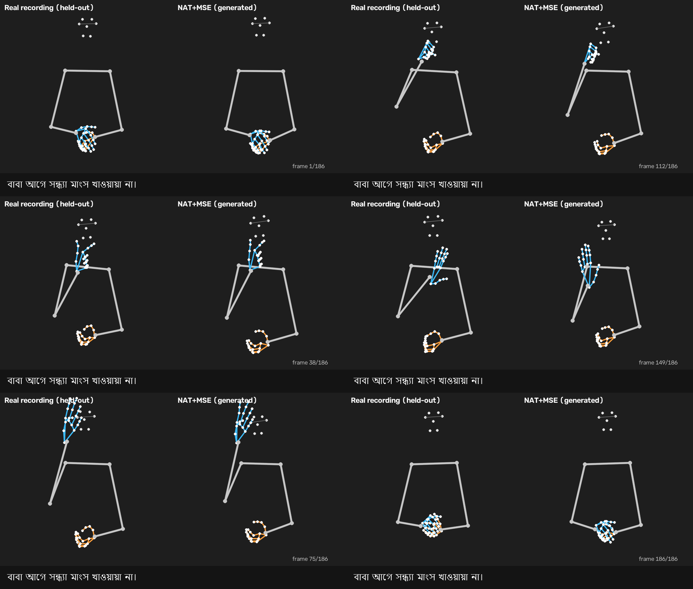
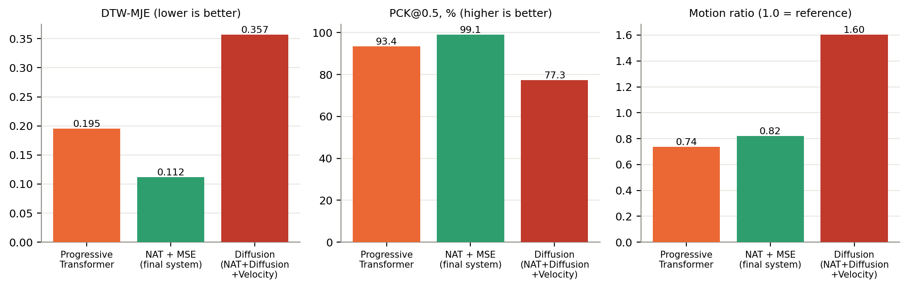

# Gloss-to-Pose Generation for Bangladeshi Sign Language (BdSL)

A learned system that turns a Bangla gloss sentence into a sequence of body, hand and head landmarks
(a skeleton "signing" video), together with a controlled comparison of three ways of generating the
motion and a leak-free evaluation protocol. To our knowledge it is the first learned
gloss-to-pose system for BdSL.

**Pipeline of the final system:** Bangla gloss → BanglaBERT encoder → duration predictor + length
regulator → feed-forward regression head (non-autoregressive, trained with masked MSE) → 95-landmark
pose sequence → skeleton video.



*Six frames from `assets/nat_mse_sign_video.mp4`: a held-out sentence, chosen by a fixed random seed.
Left: the real recording. Right: the generated output.*

## Main result

Three generators under one protocol (same sentence-disjoint split, same text encoder, 452–500 epochs,
same early-stopping rule; 192 held-out sentences, one signer, seed 42; errors in shoulder-widths):

| Model | DTW-MJE ↓ | PCK@0.5 ↑ | PCK@0.2 ↑ | Motion ratio | Back-translation word error ↓ ¹ | Inference (192 videos) |
|---|---|---|---|---|---|---|
| Progressive Transformer (autoregressive) | 0.195 | 93.4% | 67.4% | 0.74 | 42.8% | 26.1 s, sequential |
| **NAT + MSE (final system)** | **0.112** | **99.1%** | **87.5%** | 0.82 | **7.5%** | 6.1 s, parallel |
| NAT + Diffusion + Velocity | 0.357 | 77.3% | 37.9% | 1.60 | 87.4% | 32.6 s, parallel |

¹ Exploratory: the recogniser used for back-translation read 81.8% of *real* test sentences exactly,
below the 90% bar set in advance, so this column is not a clean ranking. Real signing scores 3.6%;
scoring a sentence against a wrong reference scores 83.3%.



## Findings

- **The simple model won.** A non-autoregressive regression model is the most accurate, the fastest,
  and the most readable by an independent recogniser. The diffusion model, which was the initial
  hypothesis, loses on every pose-accuracy metric and is worse than the regressor on every one of the
  192 test videos (paired Wilcoxon p ≈ 3e-33).
- **Not a training-budget artefact.** A first run stopped the diffusion model at epoch 210; resuming it
  to epoch 452 improved DTW-MJE only from 0.371 to 0.357 (`results/main_comparison/`).
- **Tested explanations that did not rescue diffusion** ([docs/experiments/](docs/experiments/)):
  velocity-term weight 0 / 3 / 10 (no clear effect), classifier-free guidance 1.0–4.0 (more guidance
  improves accuracy and increases motion together), test-time smoothness guidance and plain smoothing
  (reduce jitter, worsen accuracy), and a temporal-variance penalty on the regressor (negligible effect).
- **The diffusion model over-moves, mostly as jitter**: motion ratio 1.60 with about four times the
  reference's frame-to-frame acceleration; its output is not readable by the recogniser at any guidance
  scale tested.
- **Motion ratio needs care.** Smoothing the *real* recordings with a 5-frame average already removes
  19% of their path length (`scripts/gt_motion_smoothing.py`), so a regressor's motion ratio near 0.8
  largely reflects reference jitter no gloss-conditioned model can predict, not under-movement.
- **A leakage finding in the data protocol.** Sentence IDs are not unique glosses: on an ID-disjoint
  split, 15.1% of test sentences had a near-duplicate training gloss. Splitting on normalised gloss text
  fixes it.

Full tables are in [docs/results_tables.md](docs/results_tables.md) (generated from the CSVs), with
discussion in [docs/results.md](docs/results.md).

## Repository layout

```
README.md
docs/
  methodology.md           data, split protocol, models, losses, metrics, statistics
  results.md               findings and how each is supported
  results_tables.md        every table, generated from results/ by scripts/make_results_tables.py
  experiments/             one write-up per experiment (design, pre-registered criteria, outcome)
notebooks/                 generated by scripts/build_notebooks.py (no stored outputs)
  01_full_pipeline.ipynb   all three models trained and compared
  02_final_system_nat_mse.ipynb   the final system alone
  03_back_translation.ipynb       recogniser + back-translation of every model
  experiments/             velocity/guidance ablation, smoothness guidance, variance penalty
results/                   result CSVs (metrics only; no recordings or gloss text)
figures/                   figures regenerated from results/ by scripts/make_figures.py
assets/                    skeleton video, frame contact sheet, metadata for the chosen sentence
scripts/
  build_notebook.py        the single notebook generator (edit this, not the .ipynb files)
  build_notebooks.py       builds every notebook variant above
  make_figures.py, make_results_tables.py, make_sign_video.py, gt_motion_smoothing.py
requirements.txt
```

## Data

The recordings and gloss annotations are **not** included and are not redistributed here. The
experiments use a Bangla sign-sentence corpus of 9,610 recordings (1,922 sentences × 5 signers), each a
`(frames, 95, 3)` landmark array (33 body + 42 hand + 20 further points), laid out as
`<TENSOR_DIR>/<sentence_id>/*.npy` with the signer encoded in the filename as `_U<n>_`, plus a
spreadsheet with a `Sentence ID`, a natural sentence and the `Sign Sentence` gloss. Obtain the data from
its authors and check its licence before use. Landmarks 23–32 (hips, legs, feet) are extrapolated by the
pose extractor and are down-weighted in the objective; see [docs/methodology.md](docs/methodology.md).

## Reproducing

1. **Build the notebooks:** `python scripts/build_notebooks.py` (standard library only).
2. **Train and evaluate** on Kaggle or any GPU environment: open a notebook, attach the data, set the
   three paths in the `Config` cell (a missing path is searched for by file name under `/kaggle/input`),
   and run all cells. A single-signer run of one model takes roughly 2–3 hours on a T4.
   `02_final_system_nat_mse.ipynb` trains and evaluates the final system only. The experiment
   notebooks in `notebooks/experiments/` and `03_back_translation.ipynb` expect the checkpoints of a
   previous full run (see `RESUME_SOURCE_DIR` / `RESUME_SOURCE_FILES` in the notebook config).
3. **Figures and tables from the released CSVs:** `python scripts/make_figures.py` and
   `python scripts/make_results_tables.py`.
4. **Skeleton video for a held-out sentence** (needs the data and a trained NAT + MSE checkpoint):
   `python scripts/make_sign_video.py --tensor-dir <...> --excel <...> --ckpt <g2p_nat_mse_best.pt>`
   (`--pick-seed` selects a different sentence).

Install the local-script dependencies with `pip install -r requirements.txt`.

**Reproducibility notes.** Checkpoints are not stored (each is about 0.5 GB). The notebooks here are
regenerated from the final generator; the released CSVs came from earlier builds of the same generator,
which differ in logging (the jitter metric was added during the study) but not in model, split or
protocol. All results are a single seed (42).

**Naming.** Three models are compared throughout, under the same names in the code, the CSV `model` column and the figures: *NAT + MSE* (the final system), *Progressive Transformer* (autoregressive alternative) and *NAT + Diffusion + Velocity* (diffusion alternative, the original hypothesis).

## Limitations

- One signer for training and evaluation, one seed, 1,922 sentences drawn from a small template
  vocabulary (28–29 gloss tokens): results may not transfer to open-vocabulary or multi-signer settings,
  and a deterministic regressor likely benefits from the near-deterministic gloss-to-sign mapping.
- Automatic metrics only. DTW-MJE, PCK and the back-translation recogniser do not establish that the
  signing is understandable to Deaf signers; **no human evaluation was done**.
- The back-translation recogniser missed its pre-registered validity gate (81.8% < 90% on real poses),
  and whether the diffusion output is unreadable because it is wrong or because its jitter defeats a
  recogniser never trained on such noise is untested.
- Skeleton output only; no non-manual markers (facial expression, mouth shape); gloss input is required.
- Uniform per-token duration allocation is used as a stand-in for a forced aligner.

## License

Code is released under the MIT License (see `LICENSE`). The dataset is not part of this repository and
has its own terms.
