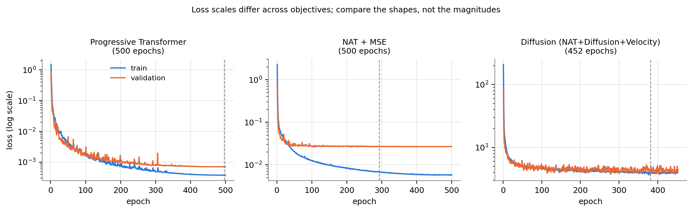
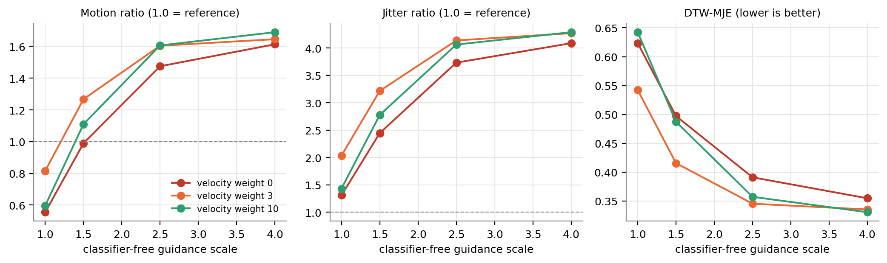
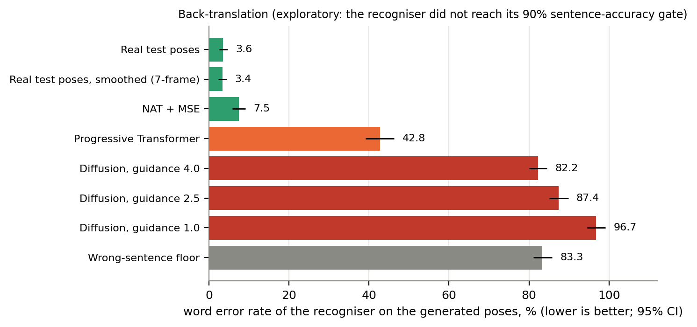

# Results and what they support

Every number here is in [results_tables.md](results_tables.md), generated from the CSVs in
`results/`. All results are one seed (42), one training signer, and the 192 held-out test sentences
unless stated. "Run 3" in the experiment write-ups means the primary three-model comparison run.

## 1. Architecture comparison

| Model | DTW-MJE ↓ | PCK@0.5 ↑ | Motion ratio | Epochs |
|---|---|---|---|---|
| Progressive Transformer | 0.195 | 93.4% | 0.74 | 500 |
| **NAT + MSE (final system)** | **0.112** | **99.1%** | 0.82 | 500 |
| NAT + Diffusion + Velocity | 0.357 | 77.3% | 1.60 | 452 |

- The diffusion model has a higher DTW-MJE than the Progressive Transformer on **100%** of the 192 test
  videos (mean +0.162, paired Wilcoxon p ≈ 3e-33) and than NAT + MSE on 100% (mean +0.245, p ≈ 3e-33).
- It also over-moves: 61% of its videos have a motion ratio above 1.5, against 0% for either of the other two models.
  Per-video motion ratio is essentially uncorrelated with per-video error (r = 0.07), so over-movement
  alone does not explain the error.
- **Training length is not the explanation.** In an earlier run the diffusion model stopped at epoch 210
  (patience 60) against 500 and 407 epochs for the other two models, giving DTW-MJE 0.371 (them: 0.205 and
  0.112). Resuming it to epoch 452 with patience 150 gave 0.357; the other two retrained from scratch
  reproduced (0.195 and 0.112). Both runs are in `results/main_comparison/`.

## 2. Velocity weight × classifier-free guidance (diffusion model)

Details: [experiments/velocity_guidance.md](experiments/velocity_guidance.md).

- Velocity weight 0 / 3 / 10 has no clear effect: at a fixed guidance the differences are small and not
  ordered by weight, consistent with single-seed noise.
- Guidance has a large monotonic effect: raising it from 1.0 to 4.0 lowers DTW-MJE (about 0.55–0.64 → about
  0.33–0.36) and raises motion ratio (about 0.56–0.82 → about 1.61–1.69) together, so lowering guidance to
  curb over-motion makes accuracy worse.
- Jitter ratio (2–4×) exceeds motion ratio in every cell: the extra motion is mostly high-frequency noise.
- Removing the velocity term entirely did **not** collapse the output (motion ratio 1.48 at guidance 2.5).
  An early run did collapse, but it also differed in other settings, so the claim that the velocity term
  fixes collapse is not established.
- No setting approaches the regressors (best DTW-MJE 0.331 vs 0.195 and 0.112).

## 3. Test-time smoothness guidance

Idea borrowed in spirit from MotionFlow (Meral et al., AAAI 2026): gradient steps on the noisy sample
during the first sampling steps to reduce frame-to-frame acceleration. Compared with simply averaging the
output over a wider window. Details: [experiments/velocity_guidance.md](experiments/velocity_guidance.md).

- Guidance cuts jitter (4.05 → about 1.2–1.5) but raises DTW-MJE (0.358 → 0.40–0.47) and lowers PCK@0.5
  (77% → 66–73%). It is no better than plain smoothing at matched jitter and costs about 2.3× the sampling
  time. Validation selects no guidance.

## 4. Temporal-variance penalty on the regressor

Hypothesis: a penalty on the gap between predicted and true per-joint temporal standard deviation restores
the "missing" motion (motion ratio 0.82) without costing accuracy. Pre-registered target: motion ratio in
0.9–1.1. Details: [experiments/nat_variance_penalty.md](experiments/nat_variance_penalty.md).

| Test set | Motion | Jitter | DTW-MJE | PCK@0.5 |
|---|---|---|---|---|
| Weight 0 (plain MSE control) | 0.818 | 0.770 | 0.1113 | 99.10% |
| Weight 2 | 0.829 | 0.775 | 0.1122 | 99.12% |
| Weight 10 | 0.829 | 0.781 | 0.1132 | 99.09% |

The penalty moved motion in the intended direction (+0.011, paired p ≈ 1e-5) but by about 1% of what was
needed; target not met, no accuracy gain. Not a contribution.

## 5. Why motion ratio stays near 0.8: the reference itself is jittery

`scripts/gt_motion_smoothing.py` smooths the **real** recordings with a moving average (40 recordings,
one signer):

| Window | Path length kept | Acceleration kept |
|---|---|---|
| 3 frames | 0.909 | 0.735 |
| 5 frames | 0.809 | 0.521 |
| 7 frames | 0.726 | 0.377 |
| 15 frames | 0.528 | 0.186 |

A 5-frame average removes 19% of the real signing's own path length, leaving 0.81, almost exactly the
regressors' motion ratio. A motion ratio near 0.8 therefore largely reflects frame-level jitter that no
gloss-conditioned model can predict, not under-movement; the frozen-output warning (below 0.5) is still
meaningful. This is a strong correlation on a small sample, not a controlled test.

## 6. Back-translation (exploratory)

A pose-to-gloss recogniser trained only on real training poses reads each model's generated poses. The
validity gate fixed in advance (≥ 90% of real test sentences read exactly) was **not** met (81.8%), so
these are exploratory. At the word level the recogniser is good (3.6% error on real poses); sentence
accuracy is lower because one wrong token fails a sentence of about five.

- NAT + MSE is close to real signing (7.5% vs 3.6% word error); the Progressive Transformer is partly
  readable (42.8%); the diffusion model is at or beyond the wrong-sentence floor (83.3%) at every guidance
  scale tested (82–97%).
- Paired bootstrap differences in word error (percentage points; all 95% CIs exclude zero): NAT + MSE vs
  Progressive −35.4 [−39.3, −31.4]; diffusion (guidance 2.5) vs NAT + MSE +80.0 [+77.3, +82.7]; diffusion
  vs Progressive +44.6 [+40.0, +49.2]; guidance 4 vs guidance 1 −14.5 [−17.5, −11.7].
- Smoothing the real poses barely affects recognition (3.4% with a 7-frame window), so the recogniser does
  not simply punish smooth output.
- **Unresolved:** whether the diffusion output is unreadable because the signing is wrong or because its
  jitter defeats a recogniser that never saw noise like that. A follow-up (score the diffusion output after
  smoothing; add matched noise to real poses) would separate the two but was not run.

Details and decision rules: [experiments/back_translation.md](experiments/back_translation.md).

## 7. Cross-signer generalisation

Generating as the training signer and scoring against four unseen signers on the same held-out sentences
(768 videos): NAT + MSE DTW-MJE 0.305, PCK@0.5 85.5%; diffusion DTW-MJE 0.468, PCK@0.5 64.7%. The
Progressive Transformer was not evaluated cross-signer. A gap relative to the same-signer test is expected
because the model imitates one signer's articulation.

## 8. What is and is not established

**Established (within one seed, one signer, this corpus):** NAT + MSE is more accurate and faster than the
Progressive Transformer and the diffusion generator and is the model to use; the diffusion model's deficit
is not explained by training length, velocity weight, guidance scale, smoothing, or its absence from a
variance penalty; the evaluation protocol (gloss-level split, DTW-aligned error, wrong-sentence and
real-pose reference points) is leak-free and internally consistent.

**Not established:** that the signing is intelligible to Deaf signers (no human evaluation); a clean
back-translation ranking (validity gate missed); that diffusion cannot help in other settings (larger,
open-vocabulary, multi-signer data); that the velocity term prevents collapse; seed-to-seed variance.
